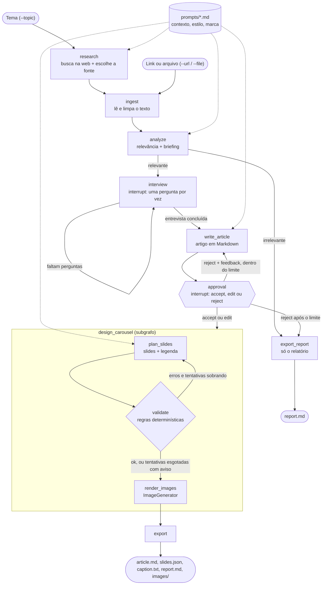
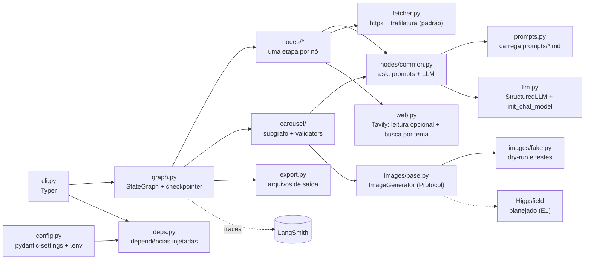

# Content Authority Pipeline

Um pipeline em LangGraph que recebe o link de um conteúdo, verifica se ele é relevante para o
contexto configurado e gera um briefing. Em seguida entrevista o autor (com `interrupt`) para
coletar suas contribuições e escreve um artigo de autoridade em Markdown, que o autor pode
aceitar, editar ou rejeitar com feedback. Aprovado o artigo, um subgrafo gera um carrossel de
Instagram (slides com frases curtas e chamada para o blog) e a legenda, seguindo uma identidade
visual definida em arquivos de prompt, com validação automática e geração de imagem por uma
interface plugável. Um modo `dry-run` roda tudo sem chamar a API de imagem.

> 🚧 **Em construção.** Miniprojeto do Microcurso 4 (AKCIT · Engenharia de Software com IA).

## Sumário

- [Como funciona](#como-funciona)
- [Arquitetura](#arquitetura)
- [Tecnologias](#tecnologias)
- [Pré-requisitos](#pré-requisitos)
- [Instalação](#instalação)
- [Configuração](#configuração)
- [Uso](#uso)
- [Estrutura do projeto](#estrutura-do-projeto)
- [Testes](#testes)
- [Como a IA acelerou este projeto](#como-a-ia-acelerou-este-projeto)
- [Limitações e próximos passos](#limitações-e-próximos-passos)
- [Créditos](#créditos)
- [Licença](#licença)

## Como funciona

1. **Fonte:** você informa um link (`--url`), um arquivo (`--file`) ou um tema (`--topic`, que
   busca a melhor fonte na web).
2. **Relevância:** o LLM decide se a fonte combina com os temas do autor (`prompts/context.md`).
   Se não combinar, o pipeline para e grava um relatório com o motivo.
3. **Entrevista:** o pipeline pausa e faz ao autor, uma por vez, as perguntas do briefing. São as
   contribuições pessoais que transformam um resumo num artigo de autoridade.
4. **Artigo:** o LLM escreve o artigo; o autor aceita, edita no próprio arquivo ou rejeita com
   feedback (o artigo é reescrito, até um limite de reescritas).
5. **Carrossel:** com o artigo aprovado, o LLM planeja os slides e a legenda. Regras
   determinísticas (número de slides, tamanho das headlines, legenda, hashtags, chamada e link
   para o blog) validam o plano; se falharem, o LLM corrige a partir da lista de erros.
6. **Saída:** artigo, slides, legenda, imagens (ou seus prompts, em dry-run) e um relatório da
   execução numa pasta própria.

## Arquitetura

O projeto é um **workflow explícito** em LangGraph: cada nó é uma etapa especializada, com o
próprio system prompt (montado a partir de `prompts/*.md`) e saída estruturada em um modelo
Pydantic. As pausas para o autor usam `interrupt` e um checkpointer. As dependências externas
(LLM, gerador de imagem, leitura e busca na web) são injetadas nos nós por um objeto `Deps`, o
que permite testar o grafo inteiro com implementações falsas.

### Fluxo do grafo



### Componentes



O adaptador real de imagem (Higgsfield) ainda não está implementado: hoje cada imagem sai como um
arquivo `.prompt.txt` com o prompt do slide.

## Tecnologias

| Área | Ferramenta |
|---|---|
| Linguagem e pacotes | Python 3.12, [uv](https://docs.astral.sh/uv/) |
| Orquestração | LangGraph 1.2 (`StateGraph`, `interrupt`, checkpointer em memória) |
| LLM | LangChain 1.4 (`init_chat_model`, `with_structured_output`), provedor configurável (OpenAI por padrão) |
| Modelos e configuração | Pydantic 2, pydantic-settings, python-dotenv |
| CLI | Typer |
| Web | httpx + trafilatura (leitura de links); Tavily (busca por tema e leitura opcional) |
| Imagem | interface `ImageGenerator`; SDK `higgsfield-client` instalado para o adaptador real |
| Observabilidade | LangSmith (traces) |
| Qualidade | pytest, ruff |

### Ferramentas de IA no desenvolvimento

| Ferramenta | Em quê |
|---|---|
| Claude (chat) | Ideação: busca e comparação de referências e seleção do MVP |
| Claude (Cowork) | Arquitetura (diagramas Mermaid, estrutura de pastas) e lista de dependências |
| Claude Code (Opus 5.5) | Implementação ticket a ticket, testes, revisão e documentação; um subagente na atualização dos documentos |
| Context7 | Consulta à documentação atualizada das bibliotecas (ex.: API do `tavily-python`) |

Como elas foram usadas está em [Como a IA acelerou este projeto](#como-a-ia-acelerou-este-projeto).

## Pré-requisitos

- [uv](https://docs.astral.sh/uv/getting-started/installation/) (ele instala o Python 3.12 se
  precisar).
- Uma chave de API de LLM (por padrão, OpenAI).
- Opcionais: chave do [Tavily](https://tavily.com) (busca por tema), do
  [LangSmith](https://smith.langchain.com) (traces) e da Higgsfield (imagens, quando o adaptador
  real existir).

## Instalação

```bash
git clone https://github.com/afcc2000/content-authority-pipeline.git
cd content-authority-pipeline
uv sync
copy .env.example .env      # Windows; no Linux/macOS: cp .env.example .env
```

Depois, preencha no `.env` pelo menos `LLM_MODEL` e a chave do provedor (ex.: `OPENAI_API_KEY`).

### Instalação alternativa com pip

Para quem não usa o uv (exige Python 3.12 instalado):

```bash
python -m venv .venv
.venv\Scripts\activate          # Windows; no Linux/macOS: source .venv/bin/activate
pip install -r requirements.txt
pip install -e . --no-deps
```

O `requirements.txt` é gerado do `uv.lock`, com as mesmas versões, e inclui `pytest` e `ruff`.
Nesse ambiente os comandos rodam sem o prefixo `uv run` (ex.: `content-pipeline demo`, `pytest`).
Quem mudar as dependências deve regenerá-lo:

```bash
uv export --format requirements.txt --no-hashes --no-emit-project -o requirements.txt
```

### Atalhos

O `Makefile` tem atalhos para as tarefas comuns. Sem `make` (o padrão no Windows), rode o
comando equivalente:

| Atalho | Comando equivalente |
|---|---|
| `make install` | `uv sync` |
| `make run` | `uv run content-pipeline run --file samples/sample_input.md` |
| `make demo` | `uv run content-pipeline demo` |
| `make test` | `uv run pytest` |
| `make lint` | `uv run ruff check .` |
| `make format` | `uv run ruff format .` |

## Configuração

Tudo é lido do ambiente ou do arquivo `.env`, que nunca é versionado.

| Variável | Obrigatória? | Para que serve |
|---|---|---|
| `LLM_MODEL` | sim | Modelo no formato `provedor:modelo`, ex.: `openai:<nome-do-modelo>` |
| `OPENAI_API_KEY` | com OpenAI | Chave do provedor do LLM (outro provedor usa a própria variável) |
| `WEB_READER` | não | Como ler links: `trafilatura` (padrão, sem chave) ou `tavily` |
| `TAVILY_API_KEY` | para `--topic` ou `WEB_READER=tavily` | Chave do Tavily |
| `IMAGE_PROVIDER` | não | `fake` (padrão) ou `higgsfield` (adaptador ainda não implementado) |
| `HF_KEY` | com Higgsfield | Credencial no formato `key-id:key-secret` |
| `BLOG_URL` | não | Se definido, a legenda do carrossel precisa conter este link |
| `LANGSMITH_TRACING`, `LANGSMITH_API_KEY`, `LANGSMITH_PROJECT`, `LANGSMITH_ENDPOINT` | não | Envio de traces para o LangSmith |

Limites ajustáveis no mesmo `.env` (padrão entre parênteses): `MAX_REWRITES` (3),
`MAX_CAROUSEL_ATTEMPTS` (2), `MIN_SLIDES` (5), `MAX_SLIDES` (10), `HEADLINE_MAX_CHARS` (80),
`CAPTION_MAX_CHARS` (2200), `MAX_HASHTAGS` (5), `IMAGE_ASPECT_RATIO` (4:5) e `PROMPTS_DIR`
(`prompts`).

Os textos que definem o autor, o estilo do artigo e a identidade visual ficam em `prompts/*.md` e
podem ser editados sem mexer no código.

## Uso

```bash
uv run content-pipeline run --url https://exemplo.com/artigo   # a partir de um link
uv run content-pipeline run --file meu_texto.md                # a partir de um arquivo
uv run content-pipeline run --topic "tema do artigo"           # busca a fonte (exige Tavily)
uv run content-pipeline demo                                   # exemplo de samples/, em dry-run
```

Informe exatamente uma fonte. Opções:

- `--out PASTA`: onde salvar os resultados (padrão: `outputs`).
- `--dry-run` / `--no-dry-run`: o padrão é dry-run, que não chama a API de imagem e grava só os
  prompts das imagens.

Durante a execução o pipeline pausa duas vezes:

1. **Entrevista:** cada pergunta aparece como `Pergunta i/n`; responda ou tecle Enter para pular.
2. **Aprovação:** o artigo é mostrado e você escolhe `accept`, `edit` (o artigo é salvo em
   `article_draft.md`; edite, salve e tecle Enter) ou `reject` (escreva o que deve mudar; a opção
   some quando o limite de reescritas acaba).

Cada execução gera uma pasta `outputs/AAAA-MM-DD-<slug>/` com:

| Arquivo | Conteúdo |
|---|---|
| `article.md` | Artigo aprovado |
| `slides.json` | Slides (headline, complemento, prompt da imagem), legenda, hashtags e chamada para o blog |
| `caption.txt` | Legenda pronta para colar, com as hashtags |
| `report.md` | Fonte, relevância, decisão, entrevista e avisos |
| `images/slide_NN.prompt.txt` | Prompt de cada imagem (dry-run) |

Se a fonte for irrelevante ou o artigo for rejeitado depois do limite de reescritas, a pasta
recebe só o `report.md`, com o motivo.

## Estrutura do projeto

```text
content-authority-pipeline/
├── src/content_pipeline/
│   ├── cli.py            # comandos run e demo; responde às pausas no terminal
│   ├── graph.py          # monta o StateGraph e o checkpointer
│   ├── state.py          # estado compartilhado do grafo
│   ├── models.py         # modelos Pydantic (Briefing, Article, CarouselPlan...)
│   ├── config.py         # Settings (pydantic-settings)
│   ├── deps.py           # dependências injetadas nos nós
│   ├── llm.py            # porta StructuredLLM e implementação com LangChain
│   ├── prompts.py        # carrega e compõe prompts/*.md
│   ├── fetcher.py        # leitura de links com httpx + trafilatura
│   ├── web.py            # Tavily: leitura opcional e busca por tema
│   ├── export.py         # grava os arquivos de saída e o relatório
│   ├── nodes/            # research, ingest, analyze, interview, write_article, approval
│   ├── carousel/         # subgrafo do carrossel: planner, validators, subgraph
│   └── images/           # porta ImageGenerator e adaptador fake
├── prompts/              # contexto do autor, estilo do artigo, marca e regras do carrossel
├── tests/                # testes com LLM e gerador de imagem falsos (tests/fakes.py)
├── samples/              # entrada de exemplo do comando demo
├── scripts/              # teste de fumaça da API de imagem (gasta créditos)
└── docs/                 # projeto, roteiro, tickets e log de uso de IA
```

## Testes

```bash
uv run pytest                 # todos os testes, sem chave de API e sem rede
uv run ruff check .           # lint
uv run ruff format --check .  # formatação
```

Os testes usam um LLM falso (`tests/fakes.py`), que devolve respostas roteirizadas, e um gerador
de imagem falso. Assim cobrem o grafo inteiro (entrevista, `accept`, `edit`, `reject`, fonte
irrelevante, validação do carrossel e exportação) sem custo. O marcador `integration` fica
reservado para testes que chamam APIs reais: eles ficam fora da execução padrão e rodam com
`uv run pytest -m integration`.

## Como a IA acelerou este projeto

Construí o projeto com o Claude Code como par de programação, um ticket por vez: a IA propunha e
implementava, eu revisava e só então autorizava cada commit. Cada interação relevante está em
[`docs/uso-de-ia.md`](docs/uso-de-ia.md), com o que pedi, o que aceitei, o que mudei ou rejeitei
e como validei. Esta seção resume esse log.

### Decisões que mudaram por causa da IA (ou apesar dela)

- **Descartei a PoC.** Gerei com IA uma prova de conceito completa em uma sessão (25 testes
  passando, ruff limpo). Funcionava, mas eu não dominava cada parte e o histórico não mostraria a
  evolução. Descartei o código e reconstruí o projeto em 28 tickets, usando a PoC como
  especificação.
- **Validação antes das imagens.** Na revisão da arquitetura, a validação do carrossel foi movida
  para antes da geração de imagem: as regras determinísticas são baratas, e gerar imagem custa
  créditos.
- **Versões conferidas, não aceitas.** A lista de dependências sugerida pela IA foi conferida no
  PyPI (versão e `Requires-Python`), instalada e testada antes de entrar no `pyproject.toml`.
- **Uma limitação real virou arquitetura.** Os modelos falsos do LangChain não suportam
  `with_structured_output` (confirmado na versão instalada). Por isso os nós dependem de uma porta
  `StructuredLLM`, e as dependências são injetadas por `Deps`: os testes usam um LLM falso próprio
  e cobrem o grafo inteiro sem chave de API.
- **O aviso do serializador do checkpoint.** O LangGraph avisava que bloquearia a desserialização
  dos modelos do pipeline. Reproduzi o problema (um `SearchResult` voltava do checkpoint como
  `dict`) e registrei os tipos no serializador.

### Onde a revisão humana fez diferença

Vários detalhes só apareceram ao conferir cada API na versão instalada, em vez de confiar na
sugestão inicial:
`init_chat_model("")` não falha (devolve um modelo configurável); o `TavilyClient` sem chave
entra num modo limitado em vez de dar erro; o `trafilatura.extract_metadata` não aceita bytes; e
o `subscribe` da Higgsfield não levanta erro quando a geração falha. Cada achado virou uma checagem
no código. No sentido inverso, a IA barrou o commit de uma chave do LangSmith colada no `.env.example`.

Também houve correções de rumo durante a construção. O limite de hashtags do Instagram caiu de 30
para 5 depois de uma pesquisa (o documento do projeto dizia 30). E, ao conferir os diagramas do
README contra o código, encontrei dois caminhos que encerravam o pipeline sem relatório (fonte
irrelevante e `reject` no limite), corrigidos com teste antes do código.

### TDD e refatoração

- **Ciclo TDD em três commits** (T19 a T21) para a regra "a legenda precisa conter o link do
  blog": o teste falhando (`cebbace`), o mínimo para passar (`ca42156`) e a refatoração com os
  testes inalterados (`af802be`). A refatoração recusou mudanças que não melhoravam nada (como
  constantes usadas uma só vez).
- **Refatoração DRY** (T22): a repetição "compor prompts + chamar o LLM" em quatro nós virou o
  helper `ask`. A IA apontou que colocá-lo em `llm.py` criaria um import circular, e ele foi para
  `nodes/common.py`. Uma duplicação anotada no T08a (a checagem de links http(s)) foi
  resolvida no mesmo commit.

### Números

O log registra: de 1 teste (T01) a 100, todos rodando sem chave de API e sem rede; 28 tickets
planejados; e 10 registros de desvio aprovado (mudanças em relação ao plano, decididas por mim
e registradas). Não medi o tempo gasto, então não estimo ganho em horas.

### Lições

- **Confira toda API na versão instalada.** As sugestões da IA nem sempre correspondem à versão
  que está no projeto.
- **O plano é uma hipótese.** Quando a IA encontra algo melhor ou um erro no ticket, o certo é
  parar, decidir e registrar, não desviar em silêncio.
- **Prompts com contrato funcionam.** Ticket com critérios de aceite, esqueleto antes do texto
  (README) e análise de impacto antes do diff (T22) deram respostas mais previsíveis.

## Limitações e próximos passos

- **Imagens reais.** O adaptador da Higgsfield ainda não existe (E1); hoje as imagens saem como
  prompts. O SDK e um teste de fumaça já funcionam, e o adaptador precisa tratar dois pontos: a
  página do modelo testado não lista a proporção 4:5, que é a padrão do projeto, e o `subscribe` não tem
  tempo limite.
- **Checkpoint em memória.** Uma execução interrompida não pode ser retomada depois (E3:
  checkpoint persistente).
- **Carrossel como agente.** O planejamento dos slides e a geração de imagem poderiam virar um
  agente com a imagem como ferramenta (E2).
- **Avaliação no LangSmith.** O dataset e os avaliadores (T23) estão planejados para depois que
  os prompts pessoais estiverem prontos.
- **Prompts pessoais.** `prompts/context.md` e `prompts/carousel_brand.md` ainda são provisórios
  (T17).
- **Fora do MVP:** interface web (o MVP é CLI), publicação e agendamento em redes sociais,
  agente autônomo de pesquisa, aprendizado a partir das edições do autor, consistência visual
  garantida entre imagens, múltiplos idiomas e múltiplas redes.

## Créditos

- [langchain-ai/social-media-agent](https://github.com/langchain-ai/social-media-agent): inspiração
  para os prompts como componentes editáveis, a verificação de relevância com relatório e a
  aprovação accept/edit/reject.
- [Documentação do LangChain e do LangGraph](https://docs.langchain.com).
- Microcurso 4 do AKCIT (Engenharia de Software com IA), que orientou as etapas do projeto.
<!-- T27: demonstração e exemplos -->

## Licença

[MIT](LICENSE) © 2026 André Felipe Cunha
