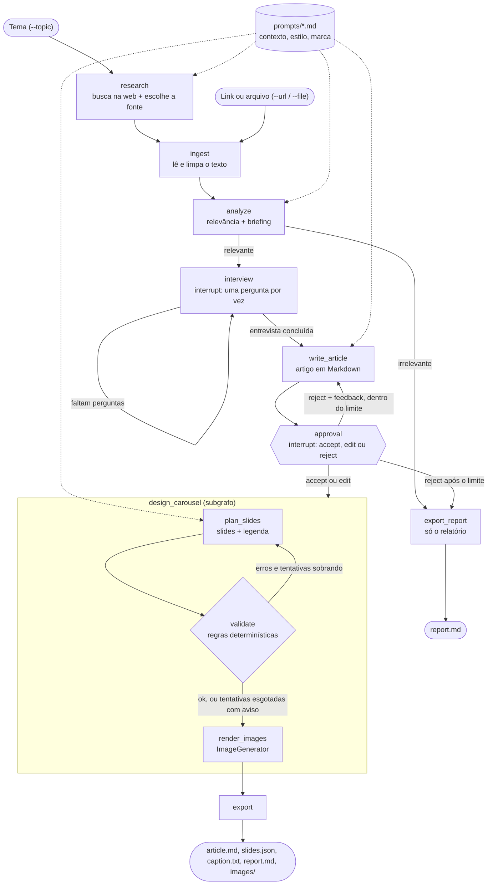
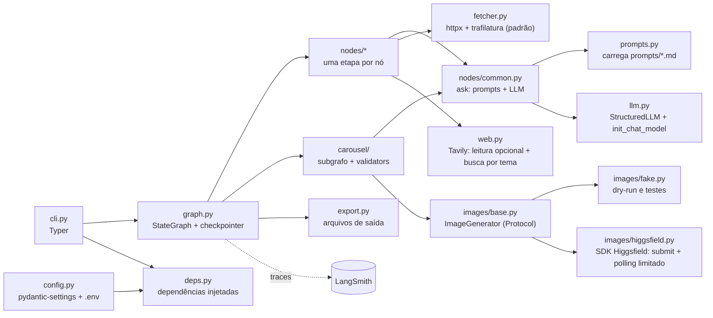

# Content Authority Pipeline — documento do projeto

> **Para que serve este documento.** É o contexto completo do projeto: o que é, por que foi desenhado assim, como as peças se encaixam e quais decisões já foram tomadas. Ele foi escrito para ser lido por você e por um assistente de código (Claude Code, Cursor, Copilot) no início de cada sessão. As etapas de execução, na ordem do material do curso, estão no documento irmão **[roteiro](roteiro.md)**.
>
> **Legenda usada nos dois documentos.** **[Material]** é exigência ou orientação dos ebooks do curso. **[Decisão]** é escolha nossa de projeto, com justificativa. **[Verificado]** foi conferido em fonte primária ou executado. **[A verificar]** ainda não foi confirmado e não deve ser tratado como fato.

---

## 1. Contexto acadêmico

O projeto é o miniprojeto do **Microcurso 4** da pós AKCIT. O objetivo do laboratório **[Material, U2 §2.1]** não é construir um sistema completo, e sim um **MVP** que permita aplicar IA generativa em várias etapas do ciclo de desenvolvimento (geração de código, testes, documentação, refatoração), em cerca de **30 horas de trabalho prático**.

A entrega tem duas partes:

1. **Repositório público no GitHub** que cumpra o checklist de submissão das Unidades 2 (§2.3.4) e 5 (§5.3.1).
2. **Postagem no fórum** de encerramento com: (a) link do repositório; (b) qual miniprojeto foi escolhido; (c) como a IA generativa apoiou o desenvolvimento; (d) desafios na organização, documentação ou submissão; (e) cuidados para revisar, testar e validar as sugestões da IA. Depois, **comentar a postagem de pelo menos um colega** (um ponto interessante, uma estratégia diferente ou um aprendizado).

Como o fórum pede o relato do uso da IA, o projeto mantém desde o primeiro dia um **log de uso da IA** (`docs/uso-de-ia.md`, ver §11). Ele alimenta a seção "Como a IA Acelerou Este Projeto" do README **[Material, U5 §5.2.1]** e a postagem do fórum.

---

## 2. O que o projeto faz

**Em uma frase:** um pipeline multiagente em LangGraph que transforma um conteúdo de referência (link ou texto) em um **artigo de autoridade** escrito com as contribuições do autor, e depois em um **carrossel de Instagram com legenda**, que aponta para o artigo.

**Fluxo de negócio:**

```
link do conteúdo → perguntas e contribuição do autor → artigo longo (blog/Medium) → carrossel + legenda
```

**Parágrafo do MVP (versão acordada):**

> Um pipeline em LangGraph que recebe o link de um conteúdo, verifica se ele é relevante para o contexto configurado e gera um briefing. Em seguida entrevista o autor (com `interrupt`) para coletar suas contribuições e escreve um artigo de autoridade em Markdown, que o autor pode aceitar, editar ou rejeitar com feedback. Aprovado o artigo, um subgrafo gera um carrossel de Instagram (slides com frases curtas e chamada para o blog) e a legenda, seguindo uma identidade visual definida em arquivos de prompt, com validação automática e geração de imagem por uma interface plugável. Um modo `dry-run` roda tudo sem chamar a API de imagem.

**Agnóstico de domínio [Decisão].** O código não sabe nada sobre psicologia, tecnologia ou qualquer área. Tudo que é específico de um autor ou marca vive em **arquivos de prompt** (`prompts/*.md`): o contexto do autor/negócio, o estilo do artigo e a identidade visual do carrossel. Trocar de domínio é trocar esses arquivos.

### 2.1 Escopo

| Dentro do MVP | Fora do MVP (vai para "Limitações e Próximos Passos") |
|---|---|
| Entrada por URL, por arquivo de texto local ou por tema (busca na web com o Tavily, T09a) **[Decisão v1.3]** | Agente autônomo de pesquisa (`create_agent` com tools de busca, várias rodadas) |
| Verificação de relevância + briefing | Publicação/agendamento em redes sociais |
| Entrevista com o autor via `interrupt` | Interface web (o MVP é CLI) |
| Artigo em Markdown com aprovação accept/edit/reject | Aprendizado automático a partir das edições (o "reflection" do social-media-agent) |
| Carrossel (texto dos slides + legenda) com validação determinística | Consistência visual garantida entre imagens (depende da API) |
| Geração de imagem por interface plugável + adaptador fake | Múltiplos idiomas, múltiplas redes |
| Modo `dry-run`, tracing no LangSmith, testes sem chave de API | Persistência durável do checkpoint (SQLite/Postgres) |

### 2.2 Definição de pronto

O MVP está pronto quando estes quatro critérios forem verdadeiros:

1. **Um comando** roda o fluxo completo em `dry-run` sobre o texto de exemplo (`samples/`) e gera a pasta de saída com `article.md`, `slides.json` e `caption.txt` (e os arquivos de imagem do adaptador fake).
2. **Os testes passam sem nenhuma chave de API** (`uv run pytest` usa modelos falsos e o adaptador de imagem fake).
3. **Os traces aparecem no LangSmith** quando a execução real roda com `LANGSMITH_TRACING=true`.
4. **O README permite que outra pessoa instale e rode** o projeto do zero.

---

## 3. Arquitetura

### 3.1 Fluxo do grafo

Os dois diagramas abaixo foram renderizados com o Mermaid CLI sem erro **[Verificado]**. O Obsidian e o GitHub renderizam Mermaid nativamente.



### 3.2 Componentes por camada



### 3.3 Padrão multiagente adotado

Na taxonomia da documentação do LangChain (subagents, handoffs, skills, router, custom workflow), o projeto é um **custom workflow** em LangGraph **[Decisão]**. Cada nó é um "agente especializado": uma chamada de LLM com seu próprio system prompt, montado a partir de `prompts/*.md`, e com **saída estruturada** em um modelo Pydantic. O fluxo entre eles é explícito (arestas do grafo), não decidido por um supervisor.

Por que assim: o fluxo do negócio é fixo e conhecido (link → entrevista → artigo → carrossel). Um fluxo explícito é mais barato, mais previsível e muito mais fácil de testar do que um supervisor decidindo a próxima etapa. O lugar natural para um agente com ferramentas é o carrossel (ver §5.6).

---

## 4. Os nós do grafo, um por um

| Nó | Entrada (estado) | O que faz | Saída (estado) | Usa LLM? |
|---|---|---|---|---|
| `research` | `topic` + `prompts/context.md` | Busca na web com o Tavily Search e escolhe a melhor fonte entre os resultados (só quando a entrada é um tema) | `source_url`, `search_results` | Sim |
| `ingest` | `source_url` ou `source_text` | Baixa a página com `httpx` e extrai o texto principal com `trafilatura` (ou com o Tavily Extract, se `WEB_READER=tavily`); ou lê o arquivo local | `source_text`, `source_title` | Não |
| `analyze` | `source_text` + `prompts/context.md` | Julga relevância para o contexto configurado e gera o briefing com perguntas para o autor | `briefing` (modelo `Briefing`) | Sim |
| `interview` | `briefing.questions`, `answers` | Faz **uma pergunta por vez** com `interrupt()`; o autor pode pular | `answers` | Não (MVP) |
| `write_article` | briefing, respostas, `feedback` (se houver) + `prompts/article_style.md` | Escreve o artigo de autoridade em Markdown | `article` (modelo `Article`) | Sim |
| `approval` | `article` | `interrupt()` com o artigo; o autor responde `accept`, `edit` (envia o texto editado) ou `reject` (envia feedback) | `decision`, `article`, `feedback`, `rewrites` | Não |
| `plan_slides` | `article` + `prompts/carousel_brand.md` + erros da validação anterior | Gera os slides (frases curtas, CTA para o blog), os prompts de imagem e a legenda | `carousel` (modelo `CarouselPlan`) | Sim |
| `validate` | `carousel` | Aplica regras determinísticas (§5.4) | `validation_errors`, `carousel_attempts` | Não |
| `render_images` | `carousel.slides[*].image_prompt` | Chama o `ImageGenerator` configurado para cada slide | `images` | Não (API de imagem) |
| `export` | tudo | Grava a pasta de saída | `output_dir` | Não |

**Roteamento:**

- No início: com `topic` → `research`; sem `topic` → `ingest`.
- Depois de `analyze`: irrelevante → encerra com relatório; relevante → `interview`.
- `interview` volta para si mesma enquanto houver perguntas sem resposta. **[Decisão]** No MVP o critério de parada é determinístico (acabaram as perguntas do briefing). Uma pergunta de follow-up decidida pelo LLM fica como stretch, porque critério determinístico é testável.
- `approval`: `reject` volta para `write_article` com o feedback (limite sugerido: 3 reescritas); `edit` e `accept` seguem para o carrossel.
- `validate`: falhou e `carousel_attempts < 2` → volta para `plan_slides` com a lista de erros no prompt; falhou de novo → segue com aviso no relatório; ok → `render_images`.

---

## 5. Decisões técnicas detalhadas

### 5.1 Estado e modelos Pydantic (esboço)

**[Material, U3 §3.1.1]** pede definir explicitamente como os dados entram e saem; aqui isso é o estado do grafo e os modelos Pydantic. Os nomes e limites abaixo são **[Decisão]** e podem ser ajustados.

```python
# models.py (esboço — não é código final)
class Briefing(BaseModel):
    is_relevant: bool
    relevance_reason: str
    summary: str
    key_points: list[str]
    angle: str                      # ângulo sugerido para o artigo
    questions: list[str] = Field(min_length=1, max_length=5)

class Article(BaseModel):
    title: str
    subtitle: str | None = None
    body_markdown: str
    tags: list[str] = []

class Slide(BaseModel):
    index: int
    headline: str                   # frase curta de impacto
    body: str | None = None
    image_prompt: str

class CarouselPlan(BaseModel):
    slides: list[Slide]
    caption: str
    hashtags: list[str] = []
    cta_text: str                   # chamada "quer ler mais?" para o blog

# state.py (esboço)
class PipelineState(TypedDict, total=False):
    source_url: str | None
    source_text: str
    source_title: str | None
    briefing: Briefing
    answers: list[str]
    article: Article
    decision: Literal["accept", "edit", "reject"]
    feedback: str | None
    rewrites: int
    carousel: CarouselPlan
    validation_errors: list[str]
    carousel_attempts: int
    images: list[str]
    output_dir: str
```

### 5.2 Human-in-the-loop (entrevista e aprovação)

**[Verificado]** O padrão abaixo foi executado com LangGraph 1.2.14: duas perguntas, um `reject` que reescreveu o artigo e um `edit` final. Funcionou como esperado.

- O nó chama `interrupt(payload)`; o grafo pausa e o `invoke` devolve o estado com a chave `__interrupt__`.
- A CLI mostra o payload, lê a resposta do autor e chama `graph.invoke(Command(resume=resposta), config)` com o **mesmo `thread_id`**.
- Isso exige um **checkpointer** no `compile()`. No MVP: `InMemorySaver` (de `langgraph.checkpoint.memory`) **[Verificado]**.
- O nó de aprovação pode devolver `Command(goto=..., update=...)` para rotear direto a partir da decisão.

Cuidados (documentação do LangGraph):

1. **Não envolva `interrupt()` em `try/except` genérico**; ele funciona lançando uma exceção especial.
2. **Ao retomar, o nó roda de novo desde o início.** Qualquer efeito colateral antes do `interrupt` (gravar arquivo, chamar API paga) precisa ser idempotente ou ficar depois dele ou em outro nó.
3. **Mantenha a ordem dos `interrupt` estável** dentro de um nó; as respostas são casadas por posição.

### 5.3 LLM: provedor configurável e testes sem chave

- `llm.py` usa `init_chat_model` (de `langchain.chat_models`) **[Verificado]** com uma string `provedor:modelo` vinda do `.env` (`LLM_MODEL`). O projeto usa OpenAI **[Decisão]**; trocar para Anthropic ou Google é mudar a variável e instalar o pacote do provedor.
- A saída estruturada usa `model.with_structured_output(MeuModeloPydantic)`.
- **Achado importante [Verificado]:** os modelos falsos do LangChain (`GenericFakeChatModel` e `FakeListChatModel`, em `langchain_core.language_models.fake_chat_models`) **não implementam `with_structured_output`** (levantam `NotImplementedError`). Eles funcionam com uma cadeia `modelo | PydanticOutputParser`, mas não com o método que vamos usar em produção.
- **[Decisão] Consequência de design:** os nós **não criam o LLM sozinhos**. O grafo é montado por uma fábrica `build_graph(deps)` que recebe as dependências (um "gerador estruturado" e o `ImageGenerator`). Em produção, o gerador estruturado chama `with_structured_output`; nos testes, um fake devolve objetos Pydantic prontos. Isso é **inversão de dependência** (o "D" do SOLID, citado na U4 §4.2.1) e é o que torna o critério 2 da definição de pronto possível.

```python
# esboço da porta (interface) usada pelos nós
class StructuredLLM(Protocol):
    def generate(self, schema: type[T], system: str, user: str) -> T: ...
```

### 5.4 Validação determinística do carrossel

Regras em `carousel/validators.py`, todas como funções puras (fáceis de testar com TDD, **[Material, U4 §4.1.2]**). Os números são **[Decisão]** configuráveis em `config.py`; os limites oficiais do Instagram **[A verificar]** antes de fixar os padrões.

- Quantidade de slides dentro de um intervalo (ex.: 5 a 10).
- `headline` com no máximo N caracteres (frase curta de ação).
- O último slide (ou o `cta_text`) contém a chamada para o blog.
- Legenda dentro do limite de caracteres e com número máximo de hashtags.
- Nenhum slide vazio; `index` sequencial; todo slide tem `image_prompt`.

**Por que a validação vem antes de gerar imagens [Decisão]:** validar texto é barato; gerar imagem custa dinheiro e tempo. Não faz sentido pagar por imagens de slides que serão descartados.

### 5.5 Geração de imagem plugável

```python
# images/base.py (esboço)
class ImageGenerator(Protocol):
    def generate(self, prompt: str, *, aspect_ratio: str, out_path: Path) -> Path: ...
```

- `images/fake.py`: não chama nada; grava um arquivo de marcação com o prompt (ou uma imagem placeholder). Usado no `dry-run` e nos testes.
- `images/higgsfield.py`: adaptador real (E1), com o SDK oficial `higgsfield-client` **[Verificado em 2026-10-14]**:
  - **Autenticação:** variável `HF_KEY` no formato `key-id:key-secret`, lida pelo SDK.
  - **Fluxo:** assíncrono. O adaptador usa `submit` (recomendado pela documentação para controlar o ciclo de vida) e um polling próprio, limitado por número de consultas e por tempo, que cancela o pedido ao estourar. O polling do SDK não tem limite.
  - **Modelo e proporção:** padrão `higgsfield-ai/soul/v2/standard`, configurável em `IMAGE_MODEL`. Os modelos Soul **recusam 4:5** na API, inclusive o Soul Standard, cuja página diz aceitar; por isso o padrão do projeto é 3:4.
  - **Concorrência:** a conta tem limite de pedidos simultâneos, e estourá-lo devolve 400, que o SDK não repete. O adaptador gera um slide por vez.
  - **Falha:** uma imagem que falha vira aviso no relatório mais o `.prompt.txt` do slide; o artigo aprovado não se perde.
  - **Ainda em aberto:** preço por imagem (fica no console da Higgsfield) e consistência de marca entre imagens (o Recraft V4.1 Pro aceita paleta de cores e é candidato).
- Outro provedor (ex.: "Nano Banana") é só mais um adaptador com a mesma assinatura.
- A escolha vem de `IMAGE_PROVIDER` no `.env` (`fake` por padrão).

### 5.6 O "agente do carrossel com a tool de imagem"

A ideia original era um agente de carrossel que tem a geração de imagem como **tool** e a identidade visual no **system prompt**. O desenho atende isso em duas camadas **[Decisão]**:

- **MVP:** a identidade visual (`prompts/carousel_brand.md`) entra no system prompt de `plan_slides`, que escreve os slides **e os prompts de imagem**. Depois, `render_images` chama o `ImageGenerator` para cada slide de forma determinística. Motivo: custo controlado (uma imagem por slide, nunca chamadas extras) e teste trivial.
- **Stretch:** o mesmo `ImageGenerator` embrulhado como `@tool generate_slide_image` e entregue a um `create_agent(model, tools=[...], system_prompt=brand)` (de `langchain.agents`, **[Verificado]** que o import existe). O agente decide quando e como chamar a tool. Isso é mais fiel à ideia original, mas mais caro e menos previsível; vale como evolução depois que o MVP estiver de pé.

### 5.7 Prompts como arquivos versionados

Inspirado no social-media-agent (BUSINESS_CONTEXT, exemplos, estrutura e regras de post como componentes editáveis) e no conceito de **promptware** do Microcurso 3 (prompts tratados como artefatos versionados, testados e reaproveitados).

```
prompts/
├── context.md          # quem é o autor, público, temas aceitos (agnóstico de domínio)
├── analyze.md          # instruções do nó analyze
├── article_style.md    # estrutura e regras do artigo; exemplos (few-shot)
├── carousel_brand.md   # identidade visual: paleta, tipografia, tom, estilo de imagem, o que evitar
└── carousel_rules.md   # estrutura do carrossel e da legenda
```

`prompts.py` carrega e compõe esses arquivos por nó. Técnicas do Microcurso 3 que se aplicam diretamente: **persona + tarefa + contexto + formato + restrições** em cada prompt; **few-shot** com exemplos de artigos e carrosséis bons; **Skeleton-of-Thought** no `write_article` (primeiro o esqueleto do artigo, depois o desenvolvimento das seções), como evolução se a qualidade pedir.

### 5.8 Segurança

O texto vindo da URL é **conteúdo não confiável**. Ele pode conter instruções escondidas (prompt injection, primeiro item do OWASP Top 10 para LLM, citado na U3 §3.3.1). Cuidados **[Decisão]**:

- Delimitar o conteúdo da fonte no prompt (ex.: entre tags `<fonte>...</fonte>`) e instruir o modelo a tratá-lo como dado, nunca como instrução.
- Limitar tamanho do download e aceitar só `http(s)`.
- Chaves só em `.env` (ignorado pelo Git); `.env.example` versionado sem valores.

### 5.9 Observabilidade e avaliação com LangSmith

- **Tracing:** basta `LANGSMITH_TRACING=true`, `LANGSMITH_API_KEY` e `LANGSMITH_PROJECT` no ambiente. O `pydantic-settings` lê o `.env` para o objeto de config, mas **não preenche `os.environ`**; por isso a CLI chama `load_dotenv()` no início.
- **Avaliação offline (U4, recomendado):** um dataset pequeno (5 a 10 textos de exemplo) criado com `Client.create_dataset` / `create_examples`; uma função alvo que roda o grafo com respostas roteirizadas em `dry-run`; avaliadores que recebem `inputs`, `outputs` e `reference_outputs`; execução com `client.evaluate()`.
- **Avaliadores sugeridos:** determinísticos (validadores passam, artigo tem título e seções, CTA presente) e um LLM-as-judge com os critérios do **Microcurso 3, U3 §3.2: coerência, pertinência e alinhamento**. Assim o próprio projeto aplica a métrica de qualidade que o curso ensinou.
- **Plano gratuito (Developer):** 5 mil traces base por mês, 1 assento, retenção de 14 dias. Suficiente para o projeto.

---

## 6. Stack e versões

**[Verificado no PyPI em 2026-10-09]**, incluindo o `Requires-Python` dos pacotes principais. **Python mínimo: 3.10**; recomendação: **3.12**.

| Uso | Pacote | Versão atual |
|---|---|---|
| Núcleo | `langchain` | 1.4.4 |
| Núcleo | `langgraph` | 1.2.14 |
| Núcleo | `langsmith` | 0.14.7 |
| LLM (provedor escolhido: OpenAI) **[Decisão]** | `langchain-openai` | 1.7.0 |
| Modelos e config | `pydantic` / `pydantic-settings` / `python-dotenv` | 2.14.0 / 2.15.0 / 1.2.4 |
| CLI e ingestão | `typer` / `httpx` / `trafilatura` | 0.27.3 / 0.28.1 / 2.3.1 |
| Leitura e busca na web (Tavily) **[Decisão v1.3]** | `tavily-python` | 0.8.5 |
| Dev | `pytest` / `ruff` | 9.1.1 / 0.17.0 |

Ambiente e dependências são gerenciados com o **`uv`** **[Decisão]** (Python, ambiente virtual e lockfile `uv.lock`). A avaliação no LangSmith não usa `openevals`: o juiz é o próprio `StructuredLLM` (ver `docs/tickets.md`, T23).

Imports conferidos em ambiente limpo com essas versões **[Verificado]**: `langchain.agents.create_agent`, `langchain.chat_models.init_chat_model`, `langgraph.graph.StateGraph`, `langgraph.types.interrupt` e `Command`, `langgraph.checkpoint.memory.InMemorySaver`, `langsmith.traceable` e `Client`.

Lembretes de API que costumam enganar assistentes de código treinados em versões antigas:

- `langgraph.prebuilt.create_react_agent` foi substituído por `langchain.agents.create_agent` no LangChain v1.
- Chains e retrievers antigos foram movidos para o pacote `langchain-classic`. Não use `LLMChain` e afins.

### 6.1 `pyproject.toml` proposto

O bloco abaixo é o formato final, depois do último ticket. No repositório, as dependências entram ticket a ticket com `uv add` (e `uv add --dev` para as de desenvolvimento), cada uma no ticket que a usa (ver [tickets](tickets.md)). **[Verificado]** Os comandos `uv add`, `uv add --dev`, `uv run` e `uv export` foram executados num projeto de teste (ver [tickets](tickets.md), "Por que `uv` e não `pip`").

```toml
[project]
name = "content-authority-pipeline"
version = "0.1.0"
description = "Pipeline LangGraph: link -> entrevista -> artigo de autoridade -> carrossel + legenda"
readme = "README.md"
requires-python = ">=3.10"
authors = [{ name = "André Felipe Cunha" }]
dependencies = [
  "langchain>=1.4,<2",
  "langgraph>=1.2,<2",
  "langsmith>=0.14,<1",
  "langchain-openai>=1.7,<2",
  "pydantic>=2.14,<3",
  "pydantic-settings>=2.15,<3",
  "python-dotenv>=1.2,<2",
  "typer>=0.27,<1",
  "httpx>=0.28,<1",
  "trafilatura>=2.3,<3",
  "tavily-python>=0.8,<1",
]

[dependency-groups]
dev = ["pytest>=9.1,<10", "ruff>=0.17,<1"]

[project.scripts]
content-pipeline = "content_pipeline.cli:app"

[build-system]
requires = ["hatchling"]
build-backend = "hatchling.build"

[tool.hatch.build.targets.wheel]
packages = ["src/content_pipeline"]

[tool.pytest.ini_options]
testpaths = ["tests"]
markers = ["integration: chama APIs reais (requer chaves no .env)"]
addopts = "-m 'not integration'"

[tool.ruff]
line-length = 100
extend-exclude = ["docs"]   # o ruff 0.17 formata blocos Python dentro de .md; os docs têm esboços
```

O `requirements.txt` com versões exatas (exigência de reprodutibilidade, **[Material, U5 §5.1.1]**) é gerado a partir do `uv.lock` no T25, com `uv export --format requirements.txt --no-hashes --no-emit-project -o requirements.txt`.

### 6.2 Variáveis de ambiente (`.env.example`)

```dotenv
# LLM — formato "provedor:modelo" usado por init_chat_model
LLM_MODEL=openai:<nome-do-modelo>
OPENAI_API_KEY=

# LangSmith
LANGSMITH_TRACING=true
LANGSMITH_API_KEY=
LANGSMITH_PROJECT=content-authority-pipeline

# Web: leitura de links (trafilatura | tavily) e busca por tema (exige a chave do Tavily)
WEB_READER=trafilatura
TAVILY_API_KEY=

# Imagem: fake | higgsfield
IMAGE_PROVIDER=fake
# Higgsfield: formato key-id:key-secret (lido pelo higgsfield-client)
HF_KEY=
```

---

## 7. Estrutura de pastas

O ebook pede uma organização por camadas/módulos **[Material, U2 §2.2.1]**, mas não fixa nomes; a estrutura abaixo é **[Decisão]** e é a mesma do Apêndice B de [tickets](tickets.md) (estado depois do T28, sem os tickets opcionais). O layout `src/` evita importar o pacote por acidente a partir da pasta errada e deixa os testes mais fiéis ao uso real.

```
content-authority-pipeline/
├── README.md
├── LICENSE                   # MIT
├── CHANGELOG.md              # Keep a Changelog (T28)
├── CLAUDE.md                 # instruções para o assistente de código (§14)
├── Makefile                  # comandos com uv run (T25)
├── pyproject.toml
├── uv.lock                   # lockfile do uv
├── .python-version           # criado pelo uv python pin
├── requirements.txt          # gerado com uv export (T25)
├── .gitignore
├── .env.example
├── docs/
│   ├── projeto.md            # este documento
│   ├── roteiro.md            # etapas do curso
│   ├── tickets.md            # ordem de construção, um commit por ticket
│   ├── uso-de-ia.md          # log de uso da IA (alimenta README e fórum)
│   └── img/                  # GIF da demonstração e prints do LangSmith (T27)
├── prompts/                  # editáveis sem tocar no código
│   └── context.md, analyze.md, article_style.md, carousel_brand.md, carousel_rules.md
├── samples/
│   └── sample_input.md       # texto de exemplo para rodar offline
├── examples/                 # saída de exemplo versionada para o README (T27)
├── src/content_pipeline/
│   ├── __init__.py
│   ├── cli.py                # Typer: run, demo; trata os interrupts no terminal
│   ├── config.py             # pydantic-settings
│   ├── deps.py               # Deps: dependências injetadas em build_graph (LLM, imagem, settings, fetch, search)
│   ├── models.py             # Briefing, Article, Slide, CarouselPlan
│   ├── state.py              # PipelineState
│   ├── llm.py                # StructuredLLM real (init_chat_model + with_structured_output)
│   ├── prompts.py            # carrega e compõe prompts/*.md
│   ├── fetcher.py            # httpx + trafilatura
│   ├── web.py                # Tavily: leitura opcional (make_fetch) e busca por tema (make_search)
│   ├── graph.py              # build_graph(deps) -> grafo compilado
│   ├── export.py
│   ├── nodes/                # research, ingest, analyze, interview, write_article, approval (common.py no T22)
│   ├── carousel/             # planner.py, subgraph.py, validators.py
│   └── images/               # base.py, fake.py, higgsfield.py (E1)
├── tests/                    # rodam sem chave de API
│   ├── fakes.py              # FakeStructuredLLM, respostas roteirizadas
│   └── test_*.py             # um arquivo por módulo, criados junto com cada ticket
├── evals/                    # dataset.py, run_eval.py (T23, opcional)
└── outputs/                  # saída das execuções (ignorada pelo Git)
```

O repositório local fica em `C:\Users\afcc2\dev\content-authority-pipeline`, fora do OneDrive, e o remoto é https://github.com/afcc2000/content-authority-pipeline.

**O repositório fica fora do vault do Obsidian.** Se ficar dentro, o `.obsidian/` e as notas pessoais poluem o repositório público.

---

## 8. Interface (CLI)

```bash
# fluxo completo, interativo, sem gastar com imagem
uv run content-pipeline run --file samples/sample_input.md --dry-run

# a partir de um link
uv run content-pipeline run --url https://exemplo.com/artigo --dry-run

# com imagens reais (requer IMAGE_PROVIDER e chaves)
uv run content-pipeline run --url https://exemplo.com/artigo --no-dry-run --out outputs/
```

Durante a execução, a CLI mostra cada pergunta da entrevista e depois o artigo, e pede `accept` / `edit` / `reject`. Para `edit`, a forma mais simples é a CLI gravar o artigo num arquivo, você editar e confirmar. Os nomes de comando e flags são **[Decisão]** e podem mudar na implementação.

---

## 9. Estratégia de testes

Segue a orientação da documentação do LangChain (testes unitários com modelos falsos e persistência em memória; testes de integração com chamadas reais; avaliações) e a U4 do curso.

| Nível | O que cobre | Precisa de chave? |
|---|---|---|
| Unitário | validadores, modelos Pydantic, carregamento de prompts, funções de roteamento, fetcher (com `httpx` simulado), adaptador fake, export | Não |
| Grafo | fluxo completo com `FakeStructuredLLM` + `FakeImageGenerator`, respostas roteirizadas com `Command(resume=...)`, casos `accept`, `edit`, `reject` e "irrelevante" | Não |
| Integração (`@pytest.mark.integration`) | uma chamada real ao LLM e ao provedor de imagem | Sim, e fica fora do `pytest` padrão |
| Avaliação (LangSmith) | qualidade das saídas sobre o dataset | Sim |

---

## 10. Decisões registradas (estilo ADR resumido)

O Microcurso 1 apresenta ADRs (registros de contexto, opções, decisão e consequências) como uso de IA na fase de projeto. Versão resumida das decisões deste projeto:

| # | Decisão | Alternativa descartada | Motivo |
|---|---|---|---|
| 1 | Custom workflow explícito no LangGraph | Supervisor/handoffs | Fluxo de negócio fixo; mais barato, previsível e testável |
| 2 | Entrevista com perguntas do briefing, uma por vez | Follow-up decidido pelo LLM | Critério de parada determinístico e testável; follow-up vira stretch |
| 3 | Validar o carrossel antes de gerar imagens | Validar depois | Não pagar por imagens descartadas |
| 4 | `ImageGenerator` como interface + adaptadores | Chamar a Higgsfield direto do nó | Troca de provedor sem tocar no grafo; fake para testes e dry-run |
| 5 | Injeção de dependência via `build_graph(deps)` | Nós criando o LLM internamente | Modelos falsos do LangChain não suportam `with_structured_output` |
| 6 | Prompts em `prompts/*.md` | Prompts no código | Projeto agnóstico; marca e domínio trocados sem código |
| 7 | CLI | Interface web | Escopo de 30h; web fica como próximo passo |
| 8 | `InMemorySaver` | SQLite/Postgres | Basta para uma execução de CLI; persistência durável é próximo passo |

---

## 11. Log de uso da IA

**[Decisão]** O log fica em [docs/uso-de-ia.md](uso-de-ia.md), atualizado a cada ticket (uma linha por uso relevante da IA). Ele é a matéria-prima da seção "Como a IA Acelerou Este Projeto" do README e da postagem do fórum (itens c, d e e).

---

## 12. Inspiração e créditos

- **langchain-ai/social-media-agent:** ideia de prompts como componentes editáveis, verificação de relevância com relatório antes de gerar, e aprovação humana accept/edit/reject. O repositório não tem testes nem avaliações; este projeto acrescenta isso. Citar como inspiração no README.
- **Documentação do LangChain/LangGraph/LangSmith (docs.langchain.com):** padrões multiagente, human-in-the-loop, testes e avaliação.

---

## 13. Pendências em aberto

- [x] Escolher o provedor de LLM: **OpenAI** (`langchain-openai`, `LLM_MODEL=openai:<nome-do-modelo>`).
- [x] Escolher a ferramenta de ambiente: **`uv`** (Python 3.12 fixado com `uv python pin`, lockfile `uv.lock`).
- [x] Escolher a licença: **MIT** (André Felipe Cunha).
- [ ] Escolher o provedor de imagem real e confirmar endpoint, proporção, preço e consistência de marca **[A verificar]**.
- [ ] Confirmar limites atuais do Instagram (número de slides, tamanho da legenda, hashtags) antes de fixar os padrões dos validadores **[A verificar]**.
- [ ] Ler a **Unidade 1 do M4** quando estiver no vault e conferir se ela acrescenta requisito.
- [ ] Preencher os insumos da seção 15.

---

## 14. Instruções para o assistente de código (colar no `CLAUDE.md` do repositório)

```markdown
# Contexto do projeto
Miniprojeto do Microcurso 4 (AKCIT). Pipeline LangGraph: link → entrevista com o autor
(interrupt) → artigo de autoridade em Markdown (accept/edit/reject) → carrossel de
Instagram + legenda. Detalhes em docs/projeto.md; passos de execução em docs/roteiro.md.
Ordem de construção (um commit por ticket): docs/tickets.md.

# Como trabalhar comigo
- Sou desenvolvedor iniciante-intermediário: explique o porquê das decisões, não só os comandos.
- Faça mudanças pequenas e cirúrgicas; não reescreva o que já está estruturado sem perguntar.
- Sinalize lacunas e incertezas; não invente APIs. Confira a versão instalada antes de usar uma API.
- Use LangChain v1 / LangGraph v1: `langchain.agents.create_agent` (não `create_react_agent`),
  nada de `LLMChain`. Modelos falsos não suportam `with_structured_output`: use as fakes de tests/fakes.py.
- Nunca coloque chaves no código; tudo via .env (ignorado). Os testes devem rodar sem chave.
- Commits no padrão Conventional Commits (feat, fix, docs, refactor, test, chore), em português.
- Ao final de cada tarefa, proponha a linha correspondente para docs/uso-de-ia.md.
```

---

## 15. Insumos que você precisa fornecer

O código é agnóstico de domínio (§2); o que torna o pipeline seu são as escolhas e os arquivos abaixo. Sem eles, o projeto roda só com valores de exemplo.

### 15.1 Checklist de escolhas

- [x] **Provedor de LLM:** OpenAI (`langchain-openai` no `pyproject.toml`, `OPENAI_API_KEY` no `.env`; §6.1, §6.2). Falta escolher o **nome do modelo** em `LLM_MODEL=openai:<nome-do-modelo>`.
- [x] **Ferramenta de ambiente:** `uv` (§6, §6.1).
- [ ] **Provedor de imagem:** `fake` (padrão), `higgsfield` ou outro. Endpoint, proporção, preço e consistência de marca **[A verificar]** (§5.5).
- [x] **Licença:** MIT (André Felipe Cunha).
- [ ] **Avaliação no LangSmith:** sim ou não (§5.9; roteiro, Passo 23).
- [ ] **URL do blog** para onde o carrossel aponta (CTA e, no roteiro, a regra do Passo 21 com `BLOG_URL`).

### 15.2 Modelo para `prompts/context.md`

```markdown
# Contexto do autor

## Autor
<nome, formação/atuação, o que te dá autoridade no tema>

## Público
<quem lê; nível de conhecimento; o que essa pessoa busca>

## Temas aceitos
- <tema 1>
- <tema 2>

## Fora de escopo
- <temas que o pipeline deve marcar como irrelevantes>

## Tom de voz
<ex.: didático, próximo, sem jargão; o que nunca dizer>

## Objetivo do conteúdo
<ex.: gerar autoridade, levar leitores ao blog, atrair clientes>

## Idioma
<ex.: português do Brasil>
```

### 15.3 Modelo para `prompts/carousel_brand.md`

```markdown
# Identidade visual do carrossel

## Paleta (hex)
- Primária: #______
- Secundária: #______
- Fundo: #______
- Texto: #______

## Tipografia
<fontes de título e corpo, peso, caixa alta ou não>

## Estilo de imagem
<ex.: fotografia natural, ilustração flat, 3D; iluminação; enquadramento>

## Elementos recorrentes
<logo, assinatura, moldura, ícones, posição fixa de elementos>

## Proporção [A verificar]
<proporção dos slides; conferir o que o Instagram e o provedor de imagem aceitam>

## Tom dos slides
<frases curtas, imperativas, perguntas; limite de palavras por slide>

## O que evitar
<clichês visuais, cores, temas, textos dentro da imagem gerada, etc.>

## Estrutura do carrossel
<ex.: slide 1 gancho; slides do meio um ponto por slide; último slide CTA para o blog>

## Imagens de referência
<links ou caminhos de imagens que representam a marca>
```

### 15.4 Orientação para `samples/sample_input.md`

Um texto **real** de 600 a 1.500 palavras, dentro dos temas aceitos em `prompts/context.md`, **sem dados pessoais** (nomes, contatos, casos identificáveis). Ele é usado na demonstração (`uv run content-pipeline run --file samples/sample_input.md --dry-run`) e nos testes de ponta a ponta, por isso fica versionado no repositório público.
